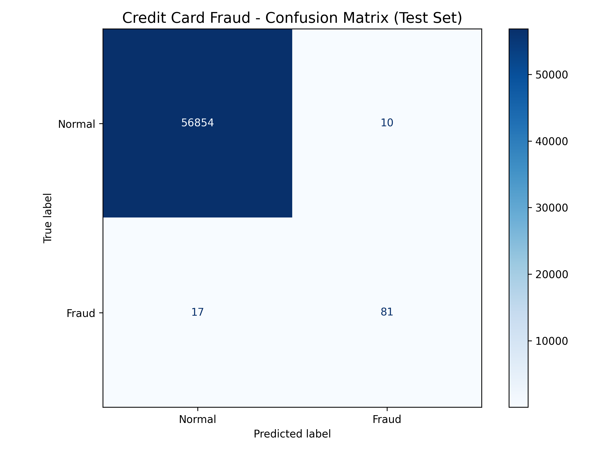

# Credit Card Fraud Detection API

Kaggle "Credit Card Fraud Detection" veri seti (284.807 işlem, %0.17 fraud) üzerinde
uçtan uca bir makine öğrenmesi projesi: analiz, leakage-free model eğitimi,
FastAPI ile servis ve Docker ile konteynerizasyon.

## Proje Bileşenleri

- **Model:** StandardScaler + SMOTE + Random Forest (`imblearn` Pipeline; SMOTE yalnızca eğitimde uygulanır)
- **Doğrulama:** 60/20/20 train / validation / test; karar eşiği validation setinde seçildi
- **Backend:** FastAPI (`/predict`, `/health`)
- **Deployment:** Docker

## Sonuçlar (Test Seti)

| Metrik | Değer |
|---|---|
| PR-AUC | 0.861 |
| Precision (fraud) | 0.890 |
| Recall (fraud) | 0.827 |
| F1 (fraud) | 0.857 |
| Karar eşiği | 0.60 (validation setinde F1 maksimizasyonu ile seçildi) |

Test setindeki 98 fraud vakasının 81'i yakalanırken 56.864 normal işlemden yalnızca 10'u yanlış alarm üretti.



## Nasıl Çalıştırılır?

```bash
docker build -t fraud-api .
docker run -p 8000:8000 fraud-api
```

Swagger UI: http://localhost:8000/docs

Örnek istek (29 değer: V1..V28, Amount):

```bash
curl -X POST http://localhost:8000/predict \
  -H "Content-Type: application/json" \
  -d '{"features": [-1.36, -0.07, 2.54, 1.38, -0.34, 0.46, 0.24, 0.10, 0.36, 0.09, -0.55, -0.62, -0.99, -0.31, 1.47, -0.47, 0.21, 0.03, 0.40, 0.25, -0.02, 0.28, -0.11, 0.07, 0.13, -0.19, 0.13, -0.02, 149.62]}'
```

## Dosyalar

| Dosya | Açıklama |
|---|---|
| `fraud_detection.ipynb` | Analiz, eğitim ve değerlendirme |
| `fraud_pipeline.joblib` | Eğitilmiş pipeline + karar eşiği |
| `main.py` | FastAPI servisi |
| `Dockerfile`, `requirements.txt` | Konteyner ve bağımlılıklar |
